<div align="center">



<br>

<a href="https://dhruvtalegaonkar.tech"></a>
<a href="https://www.linkedin.com/in/dhruv-talegaonkar-455a27259"></a>
<a href="https://app.letsdefend.io/user/cipher.0"></a>


</div>

```console
dhruv@penguin-domain:~$ whoami
Dhruv Talegaonkar | final-year B.E. IT student, Pune

dhruv@penguin-domain:~$ cat focus.txt
cloud security  ·  AI security  ·  SOC  ·  VAPT  ·  GRC

dhruv@penguin-domain:~$ status
open to paid internships and research roles (cybersecurity / cloud / AI security)
```

### `> about`

I work on **cloud security and AI security**. I spent a year as a cybersecurity intern at **EY** (SOC operations, VAPT, Active Directory security, AI and deepfake identity-threat research), and I'm a **U.S. Department of State CCI Exchange Program scholar** (Cyber Security at Northern Virginia Community College, GPA 3.89/4.00). I'm an **ISO/IEC 27001 Lead Auditor**, so I like security work that holds up in an audit as well as in an incident.

<div align="center"></div>

### `> stack`

<div align="center">

<a href="https://skillicons.dev"></a>

</div>

| Layer | What I work with |
|---|---|
| **Detect and respond** | SOC monitoring, triage, incident response |
| **Offensive** | VAPT, Active Directory security |
| **Cloud** | AWS (serverless), Azure, DevSecOps |
| **AI security** | AI and deepfake identity threats, securing AI agents |
| **Governance** | ISO/IEC 27001, GRC, compliance |

<div align="center"></div>

### `> certifications`

<div align="center">


</div>

<div align="center"></div>

### `> projects`  <sub>(click to expand)</sub>

<details>
<summary><b>serverless-soar</b> &nbsp;·&nbsp; security orchestration on AWS &nbsp;·&nbsp; <code>built, running</code></summary>
<br>

A serverless SOAR (security orchestration, automation and response) pipeline on AWS. Alerts come in, get enriched and triaged automatically, and trigger response actions without any servers to patch or pay for when idle.

**Stack:** AWS serverless services · Python

[View repository](https://github.com/penguin-domain/serverless-soar)

</details>

<details>
<summary><b>CrimeVision</b> &nbsp;·&nbsp; crime prediction and research &nbsp;·&nbsp; <code>hosted on Azure</code></summary>
<br>

Crime forecasting project and research on Chicago crime data, comparing ARIMA, LSTM and a baseline model, with a hosted front end on Azure.

**Stack:** Python · time-series models (ARIMA, LSTM) · Azure

</details>

<details>
<summary><b>AI Agent File Monitor</b> &nbsp;·&nbsp; watch what coding agents touch &nbsp;·&nbsp; <code>in testing</code></summary>
<br>

Logs which files AI coding agents access in my folders and alerts on out-of-scope access, so an agent that wanders outside its task gets caught.

**Stack:** Linux · Python

</details>

<details>
<summary><b>This profile and my portfolio</b> &nbsp;·&nbsp; <code>live</code></summary>
<br>

A scroll-driven 3D portfolio (three.js, GSAP, Lenis) deployed on Cloudflare Workers, with hardened security headers, at [dhruvtalegaonkar.tech](https://dhruvtalegaonkar.tech).

</details>

<div align="center"></div>

### `> timeline`

```text
2027        B.E. Information Technology, PCET NMIET (SPPU), Pune
2025-2026   Cybersecurity Intern, Ernst & Young (EY)
            SOC operations · VAPT · Active Directory · AI/deepfake identity threats
2024-2025   Cyber Security program, Northern Virginia Community College
            U.S. Department of State CCI Exchange Program Scholar · GPA 3.89/4.00
```

### `> now`

- Rebuilding my public repositories, starting with **serverless-soar**
- Testing the **AI Agent File Monitor**
- Planning **AutoGRC**, a RAG-based ISO 27001 policy gap checker on AWS
- Looking for a paid **internship** in cybersecurity, cloud security or AI security (Pune, Mumbai or remote)

<div align="center">


<sub>Defend by design. Audit what you build.</sub>

</div>
